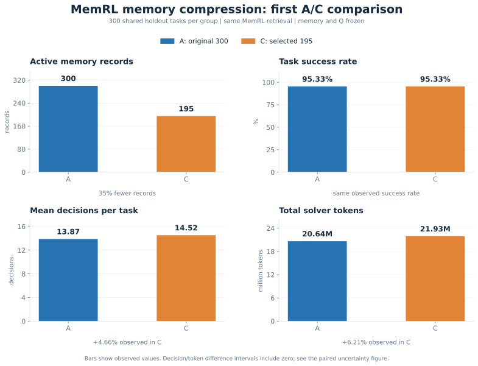
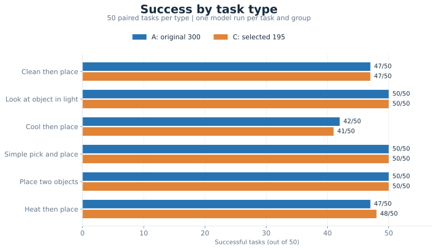
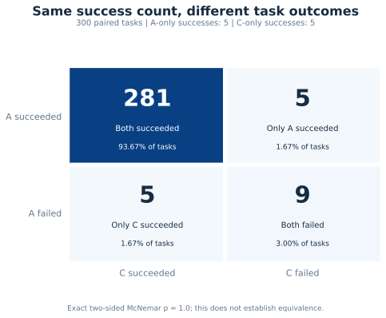

# Periodic Memory Compression for MemRL

[中文说明](README_zh.md)

An undergraduate research project exploring **periodic memory compression to improve MemRL**. ALFWorld is the agent-task benchmark for the current experiment.

The first compression step selects **195 of 300 memories (35% fewer records)**. Retained text, Q values, and feedback counts are unchanged. Selection is AI-assisted and includes capacity tradeoffs, so useful information may be lost.

## Experiment

A uses the original 300 memories; C uses the selected 195. Both use the same MemRL similarity + Q retrieval, model, and prompts. Memory and Q stay frozen. Each group attempts the same 300 tasks, with 50 tasks per type: **600 episodes in total**.

Tasks are held-out instances from the ALFWorld training pool, not official `valid_unseen`. This tests one fixed compression step; repeated-stage compression remains untested.

## Overall comparison

| Measure | A: 300 | C: 195 | C−A / relative change |
|---|---:|---:|---:|
| Completed tasks | 300 | 300 | 0 |
| Active memory records | 300 | 195 | -105 (-35.00%) |
| Original index keys | 151 | 151 | 0 |
| Successful tasks | 286 | 286 | 0 |
| Success rate | 95.33% | 95.33% | 0 pp |
| Failed tasks | 14 | 14 | 0 |
| Total decisions | 4,162 | 4,356 | +194 (+4.66%) |
| Mean decisions / task | 13.8733 | 14.5200 | +0.6467 (+4.66%) |
| Mean memory context characters / task | 3,285.22 | 3,337.25 | +52.03 (+1.58%) |
| Invalid actions | 107 | 86 | -21 (-19.63%) |
| Invalid actions / decisions (derived) | 2.57% | 1.97% | -0.60 pp |
| Separate retrieval latency | Not measured | Not measured | — |

Relative changes use A as the denominator. `pp` means percentage points. Record reduction does not establish an equal reduction in storage bytes, vectors, or runtime. Invalid-action rates are derived from invalid actions divided by all decisions.

## Token use and API accounting

| Measure | A: 300 | C: 195 | C−A / relative change |
|---|---:|---:|---:|
| Solver input tokens | 20,532,919 | 21,810,423 | +1,277,504 (+6.22%) |
| Solver output tokens | 110,158 | 114,898 | +4,740 (+4.30%) |
| Total solver tokens | 20,643,077 | 21,925,321 | +1,282,244 (+6.21%) |
| Mean solver tokens / task | 68,810.26 | 73,084.40 | +4,274.15 (+6.21%) |
| Total embedding tokens | 3,481 | 3,481 | +0 (+0.00%) |
| Solver requests / saved responses | 4,162 / 4,162 | 4,356 / 4,356 | — |
| Embedding requests / saved responses | 300 / 300 | 300 / 300 | — |
| API journal error count | 0 | 0 | 0 |
| Length-limited solver outputs | 0 | 0 | 0 |

Token counts describe usage, not currency cost. API error counts come from the request journals; they do not count environment-level interruptions. Total decisions equal solver response counts in this run.

## Results by task type

| Task type | A: 300 | C: 195 | SR difference |
|---|---:|---:|---:|
| Clean then place | 47/50 (94%) | 47/50 (94%) | +0 pp |
| Look at object in light | 50/50 (100%) | 50/50 (100%) | +0 pp |
| Cool then place | 42/50 (84%) | 41/50 (82%) | -2 pp |
| Simple pick and place | 50/50 (100%) | 50/50 (100%) | +0 pp |
| Place two objects | 50/50 (100%) | 50/50 (100%) | +0 pp |
| Heat then place | 47/50 (94%) | 48/50 (96%) | +2 pp |

Each type has 50 tasks. The one-task shifts in cooling and heating are descriptive, not established task-specific effects.

## Paired task outcomes

| Paired outcome | Tasks | Share |
|---|---:|---:|
| Both succeeded | 281 | 93.67% |
| Only A succeeded | 5 | 1.67% |
| Only C succeeded | 5 | 1.67% |
| Both failed | 9 | 3.00% |

The groups have the same overall success count but disagree on 10 tasks. Exact two-sided McNemar **p = 1.0**; this does not prove equivalence.

## What this means

- **Capacity:** 35% fewer active records, with the same observed success rate of 95.33%.
- **Efficiency:** no demonstrated decision/token saving; independent retrieval latency and actual storage-byte savings have not been measured.
- **Scope:** no formal noninferiority result and no evidence yet for repeated compression during continued MemRL training.

Next, inspect the 10 different-outcome tasks and retrieval traces, measure retrieval costs, and develop reproducible compression using separate development data. Keep this completed test fixed.

## Data and reproduction

[Experiment settings](docs/experiment.md) · [Detailed interpretation](docs/results.md) · [Plan](docs/next_steps.md) · [Compression data](data/) · [Full evaluation summary](results/eval_summary.json) · [Paired analysis](results/paired_analysis.json)

Rebuild the four charts as SVG and PNG with [tools/plot_results.py](tools/plot_results.py); see [instructions](tools/README.md). Figures use the public aggregate JSON. The full local runner and individual episode logs are not included.

The user supplied completed Ubuntu reports on 2026-11-02. Aggregate consistency was checked; underlying episodes were not independently read by the assistant. AI assisted code, screening, and documentation.

Built on [MemRL](https://github.com/MemTensor/MemRL); evaluated using [ALFWorld](https://github.com/alfworld/alfworld).
