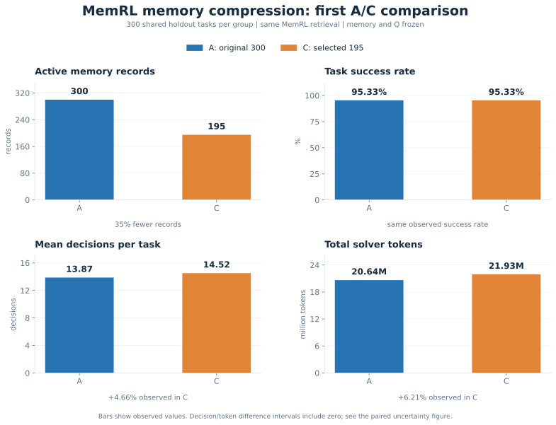
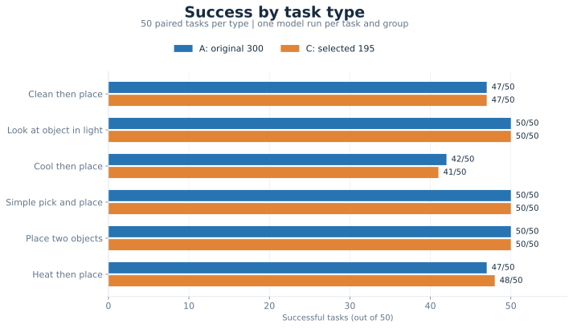
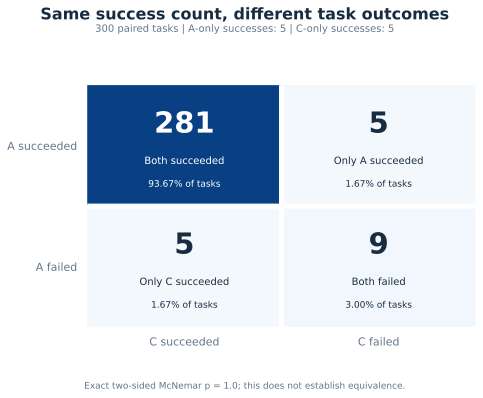
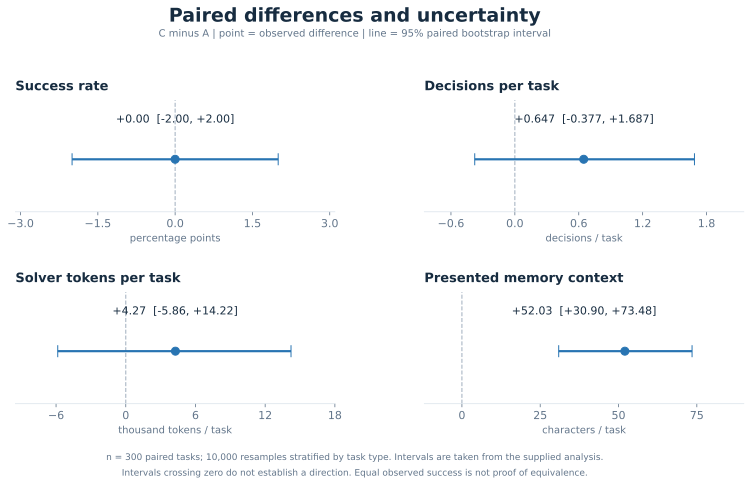

# 面向 MemRL 改进的阶段性记忆压缩研究

[English](README.md)

本项目研究如何通过**阶段性记忆压缩改进 MemRL 的记忆管理**。ALFWorld 是当前选用的智能体任务 benchmark。

第一步从 **300 条记忆中保留 195 条，条数减少 35%**。保留记录的原文、Q 值和反馈次数不变。筛选由 AI 助手协助，包含容量取舍，可能损失有用信息。

## 实验设置

A 使用原始 300 条记忆，C 使用精简 195 条。两组使用相同的 MemRL 相似度 + Q 检索、模型和提示词，测试中冻结记忆和 Q。每组完成相同的 300 题，六类任务各 50 题，**合计 600 次任务运行**。

题目来自 ALFWorld train 题池中未使用的任务实例，是自建留出集，不是官方 `valid_unseen`。本轮检验一次固定压缩，尚未验证多阶段持续压缩。

## 总体对比

| 指标 | A: 300 | C: 195 | C−A / 相对变化 |
|---|---:|---:|---:|
| 完成任务 | 300 | 300 | 0 |
| 活跃记忆条数 | 300 | 195 | -105 (-35.00%) |
| 原始索引键 | 151 | 151 | 0 |
| 成功任务 | 286 | 286 | 0 |
| 成功率 | 95.33% | 95.33% | 0 pp |
| 失败任务 | 14 | 14 | 0 |
| 决策总次数 | 4,162 | 4,356 | +194 (+4.66%) |
| 平均决策次数/题 | 13.8733 | 14.5200 | +0.6467 (+4.66%) |
| 平均记忆上下文字符数/题 | 3,285.22 | 3,337.25 | +52.03 (+1.58%) |
| 非法动作次数 | 107 | 86 | -21 (-19.63%) |
| 非法动作/决策次数（派生） | 2.57% | 1.97% | -0.60 pp |
| 独立检索耗时 | 未单独测量 | 未单独测量 | — |

相对变化以 A 为基准；`pp` 表示百分点。记忆条数减少不代表存储字节、向量或运行时间同比减少。非法动作比例由非法动作次数除以全部决策次数得到。

## Token 与 API 使用

| 指标 | A: 300 | C: 195 | C−A / 相对变化 |
|---|---:|---:|---:|
| Solver 输入 token | 20,532,919 | 21,810,423 | +1,277,504 (+6.22%) |
| Solver 输出 token | 110,158 | 114,898 | +4,740 (+4.30%) |
| Solver 总 token | 20,643,077 | 21,925,321 | +1,282,244 (+6.21%) |
| 平均 solver token/题 | 68,810.26 | 73,084.40 | +4,274.15 (+6.21%) |
| Embedding 总 token | 3,481 | 3,481 | +0 (+0.00%) |
| Solver 请求/已保存响应 | 4,162 / 4,162 | 4,356 / 4,356 | — |
| Embedding 请求/已保存响应 | 300 / 300 | 300 / 300 | — |
| API 日志错误数 | 0 | 0 | 0 |
| 输出长度截断次数 | 0 | 0 | 0 |

Token 是使用量，不是实际金额。API 错误数来自请求日志，不包含环境运行中断；本轮决策总次数与 solver 响应数相同。

## 六类任务成绩

| 任务类型 | A: 300 | C: 195 | SR 差异 |
|---|---:|---:|---:|
| 清洗后放置 | 47/50 (94%) | 47/50 (94%) | +0 pp |
| 在灯光下查看物品 | 50/50 (100%) | 50/50 (100%) | +0 pp |
| 制冷后放置 | 42/50 (84%) | 41/50 (82%) | -2 pp |
| 简单拿取并放置 | 50/50 (100%) | 50/50 (100%) | +0 pp |
| 放置两个物品 | 50/50 (100%) | 50/50 (100%) | +0 pp |
| 加热后放置 | 47/50 (94%) | 48/50 (96%) | +2 pp |

每类 50 题。制冷与加热任务的一题差异属于本轮观察，尚不能认定为稳定的分类效果。

## 逐题配对结果

| 配对结果 | 题数 | 占比 |
|---|---:|---:|
| 两组都成功 | 281 | 93.67% |
| 仅 A 成功 | 5 | 1.67% |
| 仅 C 成功 | 5 | 1.67% |
| 两组都失败 | 9 | 3.00% |

两组总成功数相同，但有 10 道题结果不同。McNemar 双侧精确检验 **p = 1.0**，不代表已经证明两组等效。

## 配对差异与不确定性

| 指标 | C−A | 95% 配对区间 |
|---|---:|---:|
| 全部 300 题：成功率（百分点） | +0.00 | [-2.00, +2.00] |
| 全部 300 题：决策次数/题 | +0.647 | [-0.377, +1.687] |
| 全部 300 题：solver token/题 | +4,274.15 | [-5,855.34, +14,224.87] |
| 全部 300 题：记忆上下文字符数/题 | +52.03 | [+30.90, +73.48] |
| 共同成功 281 题：决策次数/题 | +0.605 | [-0.317, +1.555] |
| 共同成功 281 题：solver token/题 | +3,571.12 | [-4,569.10, +11,854.46] |

区间来自按任务类型分层的 10,000 次配对 bootstrap。C 的决策与 token 平均值更高，但差异区间都包含 0；呈现给模型的记忆上下文差异区间则高于 0。这里引用本地分析报告的区间，没有重新读取逐题日志计算。

## 当前结论与下一步

- **容量：**活跃记忆条数减少 35%，两组观察成功率均为 95.33%。
- **效率：**尚未显示决策或 token 节省；独立检索耗时与实际存储字节节省还未测量。
- **研究范围：**没有完成正式非劣效检验，也尚未证明持续训练中多次阶段性压缩有效。

下一步查看 10 道结果不同的题及检索轨迹，测量检索开销，并在独立开发数据上研究可重复执行的压缩方法。当前测试保持固定。

## 数据与图表复现

[实验设置](docs/experiment.md) · [结果解读](docs/results.md) · [后续计划](docs/next_steps.md) · [压缩数据](data/) · [完整评估汇总](results/eval_summary.json) · [配对分析](results/paired_analysis.json)

四张图均由公开 JSON 生成，提供 SVG 和 PNG。绘图代码为 [tools/plot_results.py](tools/plot_results.py)，见[重绘说明](tools/README.md)。本仓库暂未包含本地完整运行包和逐题原始日志。

用户于 2026-11-02 提供 Ubuntu 完整结果报告；已核对汇总一致性，助手未独立读取 600 次任务的底层日志。代码、筛查和文档使用了 AI 协助。

基于 [MemRL](https://github.com/MemTensor/MemRL)，使用 [ALFWorld](https://github.com/alfworld/alfworld) 进行当前验证。
